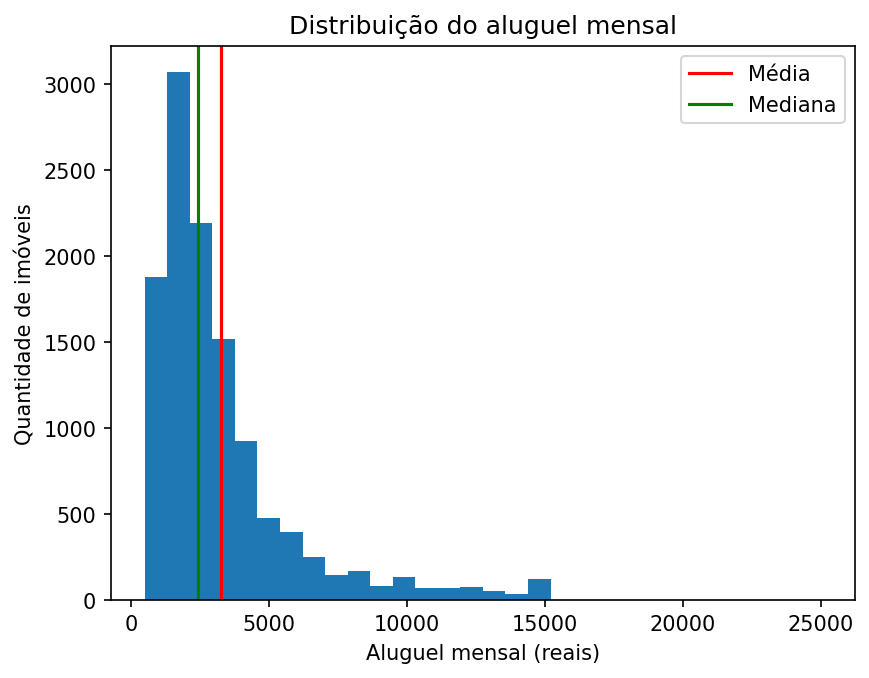
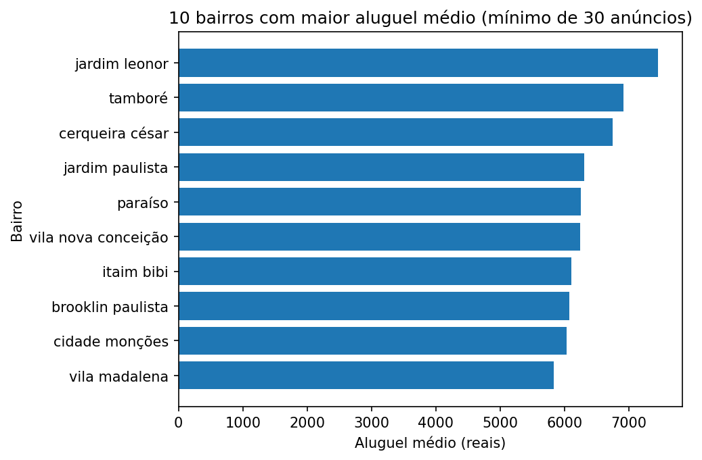
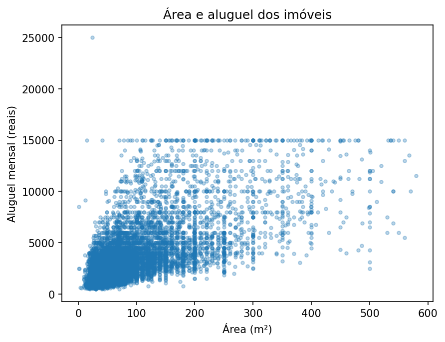

# Análise de aluguel em São Paulo

**Desafio inicial SYNAPTA (Edital nº 1/2026), Opção 1: Análise de preços de aluguel em São Paulo**

- **Candidato:** Jonathan Victor Batista de Jesus
- **Matrícula:** 01901789
- **Curso:** Ciência da Computação, UNINASSAU Maceió
- **Período atual:** 2º período

---

## Pergunta orientadora

> Quais características parecem acompanhar os maiores e os menores preços de aluguel e o que os dados não permitem concluir?

## Dataset

- **Nome:** Sao Paulo Housing Prices (Kaggle, autor: renatosn)
- **Link:** https://www.kaggle.com/datasets/renatosn/sao-paulo-housing-prices
- **Licença:** CC0 1.0 Universal (domínio público), que permite uso e redistribuição. Por isso o arquivo `data.csv` está incluído neste repositório.
- **Tamanho:** 11.657 linhas e 8 colunas (11.655 linhas depois da limpeza).

### Colunas usadas

Descrições conferidas na página do dataset no Kaggle e reescritas por mim.

| Coluna | O que representa |
|---|---|
| address | endereço (rua) do imóvel |
| district | bairro ou distrito onde o imóvel fica |
| area | área do imóvel em metros quadrados (m²) |
| bedrooms | número de quartos |
| garage | número de vagas de estacionamento |
| type | tipo do imóvel (apartamento, casa, studio e kitnet, casa em condomínio) |
| rent | aluguel mensal |
| total | custo total: aluguel mais impostos e outras taxas |

Colunas criadas por mim durante a análise (não existem no arquivo original): `district_norm` (nome do bairro padronizado) e `diferenca` (`total` menos `rent`).

## Ferramentas

- Python 3
- pandas (leitura, limpeza e cálculos)
- matplotlib (gráficos)
- Google Colab (ambiente de execução)

## Estrutura do repositório

```
.
├── README.md
├── requirements.txt
├── data/
│   └── data.csv                    # dataset original (licença CC0)
├── img/
│   ├── grafico_1_histograma_aluguel.png
│   ├── grafico_2_bairros_mais_caros.png
│   └── grafico_3_area_aluguel.png
└── notebooks/
    └── analise_aluguel_sp.ipynb    # notebook com toda a análise
```

## Como executar

**Opção 1: Google Colab (a mais simples)**

1. Abra [https://colab.research.google.com](https://colab.research.google.com) e use **Arquivo > Fazer upload de notebook** para enviar `notebooks/analise_aluguel_sp.ipynb`.
2. Na barra lateral esquerda, clique no ícone de pasta e depois no de upload, e envie o arquivo `data/data.csv` (ele deve ficar na raiz do Colab, ao lado do notebook).
3. Use **Ambiente de execução > Executar tudo**. Pandas e matplotlib já vêm instalados no Colab.

**Opção 2: no computador**

```
git clone <link-deste-repositorio>
cd <pasta-do-repositorio>
pip install -r requirements.txt
pip install notebook
```

Copie `data/data.csv` para dentro da pasta `notebooks/`, ao lado do notebook, porque o código lê o arquivo como `data.csv`. Depois execute:

```
jupyter notebook notebooks/analise_aluguel_sp.ipynb
```

Se preferir baixar o dataset direto da fonte, use o link do Kaggle acima. Os gráficos usados neste README estão na pasta `img/`.

## Preparação e limpeza dos dados

| Verificação | Resultado | Decisão |
|---|---|---|
| Valores ausentes | nenhum em nenhuma coluna | nada a fazer |
| Linhas repetidas | nenhuma | nada a fazer |
| `area` igual a 0 | 2 imóveis (um apartamento de 2 quartos e uma casa de 3 quartos), menos de 0,02% | **removidos**, porque área 0 é impossível; criei o `df_limpo` com 11.655 linhas e mantive o `df` original |
| `type` | 4 categorias, todas escritas de forma consistente | nada a fazer |
| `district` | 1.199 nomes, com variações de escrita (espaços, maiúsculas, ponto final, como "Pacaembu.") | criei `district_norm` (sem espaços sobrando, em minúsculas, sem ponto final): **1.178 bairros**, 21 duplicatas eliminadas; a coluna original foi mantida |
| `rent` maior que `total` | 0 casos; `total` é sempre maior (diferença mínima de 9, mediana de 577, máxima de 13.700) | nada a fazer |
| `bedrooms` igual a 0 | 37 imóveis: 26 studios e kitnets (esperado), 7 apartamentos pequenos (22 a 47 m²) e 4 casas (suspeitas, uma tem 250 m² e 3 vagas) | **mantidos** e registrados como limitação |
| Aluguel de R\$ 15.000 e R\$ 25.000 | 113 anúncios (1%) têm exatamente R\$ 15.000 e só um passa disso: um studio de 24 m² a R\$ 25.000 | **mantidos** e registrados como limitação |

## Resultados

### Média e mediana do aluguel

- Média: **R\$ 3.250,96**
- Mediana: **R\$ 2.415,00**

A média é maior porque poucos aluguéis muito altos a puxam para cima (cauda comprida à direita no histograma). A mediana, que é o valor do meio, quase não é afetada por eles e descreve melhor o aluguel típico.



*O histograma mostra que a maioria dos imóveis tem aluguel mais baixo e poucos têm aluguéis muito altos. A linha vermelha marca a média e a verde marca a mediana.*

### Por tipo de imóvel

| Tipo | Média (R\$) | Mediana (R\$) | Imóveis |
|---|---|---|---|
| Studio e kitnet | 2.128 | 1.850 | 1.381 |
| Casa em condomínio | 3.913 | 2.200 | 241 |
| Apartamento | 3.357 | 2.500 | 7.193 |
| Casa | 3.472 | 2.600 | 2.840 |

A casa em condomínio tem a maior média, mas a mediana é baixa. Como são só 241 imóveis, poucos aluguéis altos elevam a média.

### Por bairro

Foram usados apenas bairros com **pelo menos 30 anúncios** (78 bairros, que cobrem 5.877 dos 11.655 imóveis, cerca de 50%). Com poucos anúncios, a média de um bairro fica frágil: por exemplo, Alphaville lidera o ranking no corte de 10 anúncios com apenas 24 imóveis e sai da lista quando o corte sobe para 30.

**Cinco bairros com maior aluguel médio**

| Bairro | Média (R\$) | Mediana (R\$) | Anúncios |
|---|---|---|---|
| jardim leonor | 7.456 | 7.428 | 38 |
| tamboré | 6.913 | 6.550 | 34 |
| cerqueira césar | 6.751 | 5.925 | 140 |
| jardim paulista | 6.306 | 5.000 | 220 |
| paraíso | 6.250 | 4.556 | 90 |

**Cinco bairros com menor aluguel médio**

| Bairro | Média (R\$) | Mediana (R\$) | Anúncios |
|---|---|---|---|
| taboão | 1.473 | 1.250 | 49 |
| sé | 1.593 | 1.400 | 63 |
| campos elíseos | 1.647 | 1.550 | 117 |
| santa efigênia | 1.648 | 1.390 | 43 |
| vila ema | 1.737 | 1.575 | 36 |

Testei também os cortes de 10 e 50 anúncios: o ranking muda, e só Cerqueira César aparece entre os 10 mais caros nos três cortes.



*O gráfico mostra os 10 bairros com maior aluguel médio entre os que têm pelo menos 30 anúncios.*

### Aluguel e características do imóvel

Correlação do aluguel com: **área 0,67**, **vagas 0,62** e **quartos 0,53**. As três relações são moderadas, e as características também se relacionam entre si (correlações de 0,66 a 0,73), então não dá para separar o efeito de cada uma.

| Quartos | Média (R\$) | Mediana (R\$) | Imóveis |
|---|---|---|---|
| 0 | 2.237 | 1.400 | 37 |
| 1 | 2.154 | 1.711 | 4.193 |
| 2 | 2.750 | 2.200 | 4.346 |
| 3 | 4.796 | 3.800 | 2.422 |
| 4 | 7.806 | 7.200 | 543 |
| 5 | 8.568 | 8.000 | 91 |
| 6 | 8.346 | 8.000 | 23 |

Os grupos de 0 e de 6 quartos são pequenos e irregulares, então a mediana deles é mais confiável.



*Cada ponto é um imóvel. Em geral, quanto maior a área, maior o aluguel, mas a relação não é perfeita. A linha de pontos em R\$ 15.000 corresponde aos 113 anúncios com esse valor exato, e há um imóvel isolado em R\$ 25.000.*

## Conclusões

1. A mediana do aluguel é R\$ 2.415 e a média é R\$ 3.250,96. A média fica acima porque poucos aluguéis muito altos a puxam para cima.
2. Studio e kitnet é o tipo mais barato (mediana de R\$ 1.850), contra R\$ 2.500 do apartamento e R\$ 2.600 da casa.
3. O aluguel acompanha a área (correlação de 0,67) e os quartos: a mediana sobe de R\$ 1.711 com 1 quarto para R\$ 8.000 com 5 quartos, cerca de 4,7 vezes.
4. Entre os bairros com pelo menos 30 anúncios, o mais caro é Jardim Leonor (média de R\$ 7.456) e o mais barato é Taboão (R\$ 1.473), uma diferença de cerca de 5 vezes.
5. Os anúncios são muito concentrados: apartamentos são 62% do total, e os 78 bairros com pelo menos 30 anúncios, de 1.178, cobrem só cerca de 50% dos imóveis.

**Resposta à pergunta orientadora.** Os maiores aluguéis acompanham imóveis maiores, com mais quartos e mais vagas, e bairros como Jardim Leonor, Tamboré e Cerqueira César. Os menores aparecem em studios e kitnets e em bairros como Taboão, Sé e Campos Elíseos. Os dados não permitem concluir que uma característica *cause* o aluguel (correlação mostra só que as coisas andam juntas), nem saber o preço negociado, o estado do imóvel ou o efeito isolado de cada característica.

## Limitações

- Os valores são de anúncios, e o preço anunciado pode ser diferente do preço negociado.
- Os anúncios são concentrados: 62% são apartamentos, e só 78 dos 1.178 bairros têm pelo menos 30 anúncios. O ranking de bairros cobre cerca de metade dos imóveis.
- O ranking muda conforme o corte de anúncios escolhido (10, 30 ou 50).
- Não verifiquei se bairros como Alphaville, Tamboré e Taboão ficam na cidade de São Paulo, então o dataset pode incluir imóveis de fora da capital.
- Cerca de 113 anúncios (1%) têm aluguel de exatamente R\$ 15.000, o que forma um pico no histograma, e só um imóvel passa disso (R\$ 25.000, um studio de 24 m² que destoa do tipo). Os dados não permitem saber o motivo, e mantive esses imóveis na análise.
- 37 imóveis têm 0 quartos. Isso é esperado em studios, mas 4 casas nessa situação (uma delas com 250 m²) sugerem que o número de quartos pode não ter sido preenchido.
- O dataset não informa quando os anúncios foram coletados, e não tem banheiros, idade do imóvel nem estado de conservação.
- Bairros com nomes parecidos, como "centro" e "centro histórico de são paulo", aparecem separados e não foram unificados.
- Correlação não prova causa, e como área, quartos e vagas se relacionam entre si, não dá para separar o efeito de cada uma.

 ## Sugestões baseadas nos dados

 Para comparar preços de aluguel, usar a **mediana** em vez da média, porque poucos aluguéis muito altos puxam a média para cima.
 Quem procura aluguel mais barato pode começar por **studios e kitnets** (mediana de R$ 1.850) e por bairros como Taboão, Sé e Campos Elíseos, que tiveram as menores médias entre os bairros com pelo menos 30 anúncios. Isso vale só para os anúncios deste dataset e não diz nada sobre o motivo dos preços.
 Em uma próxima análise, conferir a **cidade de cada anúncio** (por exemplo, Tamboré e Alphaville) para ter certeza de que todos são da capital.
 Em uma próxima análise, buscar dados com **data de coleta, banheiros e estado do imóvel**, que ajudariam a separar melhor o efeito de cada característica.
 Comparar o aluguel **dentro do mesmo bairro**, e não só no total, para reduzir o peso da localização na relação com a área e os quartos.

## Declaração de uso de inteligência artificial generativa

**Ferramenta:** Claude (Anthropic), em conversa de chat.

**Finalidade:** aprender comandos do pandas, receber orientação sobre a ordem da análise e a organização do notebook, e receber exemplos de código (filtros, `groupby`, a linha que cria a coluna `district_norm` e o código dos gráficos) e rascunhos de alguns textos explicativos, que adaptei e revisei.

**O que fiz eu mesmo:** baixei o dataset, escrevi e executei as células no Colab, interpretei os resultados, escolhi o corte de 30 anúncios, decidi remover os 2 imóveis com área 0 e organizei o notebook.

**Como verifiquei:** executei todos os comandos no Colab e conferi os números nas saídas (por exemplo, de 11.657 para 11.655 linhas e de 1.199 para 1.178 bairros), confirmei o significado das colunas e a licença na página do dataset no Kaggle e executei o notebook do zero. Consigo explicar cada etapa da análise.

## Fonte e licença

Dados: *Sao Paulo Housing Prices*, de renatosn, no Kaggle, sob licença CC0 1.0 Universal (domínio público): https://www.kaggle.com/datasets/renatosn/sao-paulo-housing-prices
